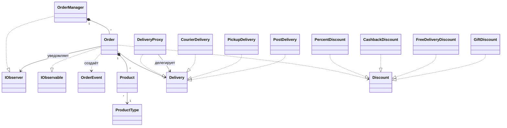

# Система управления заказами

## Архитектура



**Наблюдатель.** Менеджер подписывается на заказ при создании. Заказ проверяет переход статуса и передаёт подписчикам идентификатор, прежний и новый статусы и время события. Заказ фиксирует итоговую цену при оплате. Менеджер учитывает эту сумму и зачисляет бонусы клиенту. При доставке или отмене освобождает место в общем и персональном лимитах. История платежей позволяет запросить оборот за полуинтервал времени. Уникальные клиенты учитываются с первого заказа, включая отменённые.

**Стратегия.** Курьер берёт 500 рублей за посылку до 20 кг, почта — 200 рублей до 10 кг. Самовывоз бесплатен при любом весе. Заказ принимает акции через интерфейс Discount. Процентная скидка уменьшает сумму товаров и доставки на 10%, бесплатная доставка снимает плату за перевозку, подарок добавляет кружку весом 0,3 кг. Кешбэк составляет 5% от итоговой оплаты. Проценты округляются до копеек.

**Прокси.** DeliveryProxy проверяет разрешённые регионы и собственный предел веса, затем ограничения перевозчика. После проверки прокси ищет тариф в кеше по региону и весу. Такой ключ соответствует используемым тарифам с фиксированными условиями для пары «регион, вес». Изменение состава заказа, нарушающее лимит выбранной доставки, отклоняется. Локальный LoggingProxy пишет операции с источниками ORDER, DELIVERY, DISCOUNT и MANAGER.

**Легковес и владение.** Статический каталог выдаёт общие неизменяемые объекты ProductType. Каждая позиция хранит собственные цену и количество. Заказ сохраняет неизменяемые снимки позиций через shared_ptr<const Product>, которыми может владеть и получатель getItems(), и разделяет стратегию доставки через shared_ptr. Менеджер владеет заказами и возвращает стабильные ссылки на них. Копирование заказа и менеджера запрещено, чтобы сохранить идентичность заказов и подписок. Внешний слушатель должен отписаться перед своим уничтожением, если заказ продолжает работать.

## Операторы

| Выражение | Результат |
| --- | --- |
| order + product | Добавляет позицию с уникальным идентификатором |
| order - id | Удаляет позицию |
| order + discount | Применяет акцию |
| order * count | Рассчитывает стоимость нескольких одинаковых заказов, включая доставку каждого |
| delivery << order | Назначает заказу выбранную доставку после проверки доступности |
| stream << order | Выводит номер, клиента, статус, вес и сумму |

Операции изменения возвращают ссылку на тот же заказ. Оплаченный заказ закрыт для редактирования. Отменить заказ можно до оплаты.

## Проверка

Язык реализации — C++17, компилятор — GNU C++ 16.2.1. Из корня проекта выполните

```bash
cmake -S . -B build
cmake --build build
./build/orders
(cd build && ctest --output-on-failure)
run-clang-tidy -p build
```

| Сценарий | Наблюдаемый результат |
| --- | --- |
| Две книги по 500 рублей, скидка 10% | Товары стоят 900 рублей |
| Назначение курьера через прокси | Срок 1–2 дня, итог 1350 рублей |
| Оплата, отправка и доставка | Оборот 1350 рублей, место для следующего заказа освободилось |
| Четыре акции на второй заказ | Вес с подарком 2,3 кг, оплата 900 рублей, на счёт зачислено 45 бонусов |
| Отмена и повторный заказ Бориса | Создан заказ №4, в системе два клиента и два активных заказа |

Тесты CTest проверяют повторную подписку и отписку, учёт платежа в периоде, повторную оплату, лимиты и замену отменённого заказа. Тестовый перевозчик считает обращения к тарифу и позволяет проверить попадание в кеш и новый расчёт после изменения веса. Проверяются также границы веса, отказ по региону, сочетание акций и перегрузки операторов.

Заказ отвечает за допустимые изменения состава и статуса. Менеджер обновляет статистику по событиям независимо от того, вызвал смену статуса клиентский код или сам менеджер.
